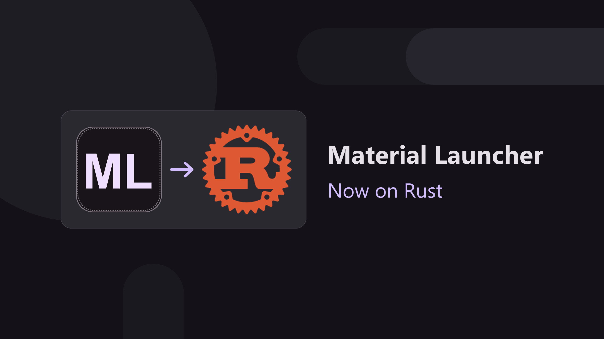

<div align="center">

  <p>
    <a href="README.md"><strong>🇬🇧 English</strong></a> &nbsp;|&nbsp; 
    <a href="README_RU.md">🇷🇺 Русский</a>
  </p>

  <a href="https://imgur.com/a/hpicWJo">
    
  </a>

  <p><strong>A clean, fast, and modern Minecraft launcher built on Material Design 3 (Material You).</strong></p>

  <p>
    
    
    
    
  </p>

</div>

<br>

<div align="center">
  
</div>

<br>

<div align="center">
  <a href="https://imgur.com/a/lW37YVm">
    
  </a>
</div>

---

## 🎨 Why another launcher?

Most existing Minecraft launchers are either stuck in 2014, cluttered with ads, or look like Windows XP utilities.

**Material Launcher** is built for people who appreciate clean design:
- **No visual clutter** — interface following **Google Material Design 3** guidelines: soft accent colors, rounded corners, an adaptive dark theme, and fluid animations.
- **Everything within reach** — single-click launch, easy instance management, and direct mod installs without getting lost in nested menus.

---

## ✨ Features

- 🎮 **Any version & loader**: Pure Vanilla, Fabric, Forge, NeoForge, and Quilt ready to install on the fly.
- 🔑 **Flexible authentication**:
  - Official **Microsoft** accounts (OAuth 2.0)
  - **Ely.by** (with custom skins & capes support)
  - **Offline mode** (for LAN play or playing without internet)
- 🧩 **Built-in mod browser**: Search and install mods directly from **Modrinth** and **CurseForge** without leaving the app.
- 📦 **Cross-platform packaging**:
  - **Windows**: Portable `.exe` (zero-install), Setup `.exe`, `.msi`, and `.zip`.
  - **Linux**: `.AppImage`, `.deb`, `.rpm`, `.flatpak`, `.tar.gz`, and `.zip`.
- 📰 **News feed**: Latest news, snapshot announcements, and game updates straight on your home screen.

---

## 📦 Downloads

All builds are compiled natively through CI/CD:

| Platform | Formats | Details |
| :--- | :--- | :--- |
| **Windows** | `Setup .exe` | NSIS installer with shortcuts (~5.5 MB) |
| | `Portable .exe` | Standalone executable, leaves no junk behind (~18.7 MB) |
| | `.msi` | Windows Installer package (~7.9 MB) |
| **Linux** | `.AppImage` | Universal bundle for any distro |
| | `.deb` | Ubuntu, Debian, Linux Mint, Pop!_OS (~8.1 MB) |
| | `.rpm` | Fedora, openSUSE, RHEL (~8.1 MB) |
| | `.tar.gz` | Portable binary archive (~7.9 MB) |

---

## 🛠 Building & Running from Source

Requires **Rust** (stable) and **Tauri CLI v2** (`cargo install tauri-cli --version "^2"`):

```bash
# Clone the repository
git clone https://github.com/valdr1210/MaterialLauncherV2.git
cd MaterialLauncherV2

# Start in development mode
cargo tauri dev
```

### Build Commands:

```bash
# Build for Windows (Setup EXE, MSI, Portable EXE)
cargo tauri build --bundles nsis,msi

# Build for Linux (AppImage, DEB, RPM)
cargo tauri build --bundles deb,rpm,appimage
```

---

<div align="center">
  <a href="https://imgur.com/a/mnwiRM5">
    
  </a><br>
  <sub>Material Launcher • Released under the MIT License</sub>
</div>
