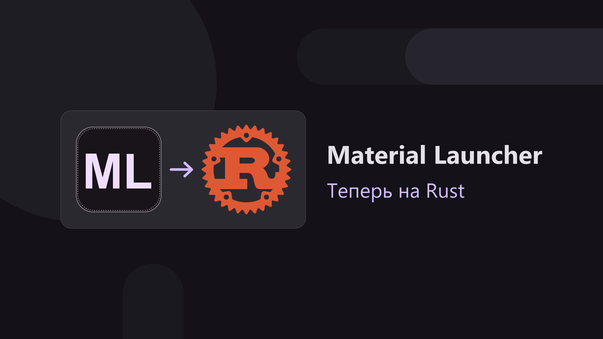

<div align="center">

  <p>
    <a href="README.md">🇬🇧 English</a> &nbsp;|&nbsp; 
    <a href="README_RU.md"><strong>🇷🇺 Русский</strong></a>
  </p>

  <a href="https://imgur.com/a/hpicWJo">
    
  </a>

  <p><strong>Быстрый, чистый и приятный Minecraft лаунчер на Material Design 3 (Material You).</strong></p>

  <p>
    
    
    
    
  </p>

</div>

<br>

<div align="center">
  
</div>

<br>

<div align="center">
  <a href="https://imgur.com/a/lW37YVm">
    
  </a>
</div>

---

## 🎨 Зачем ещё один лаунчер?

Большинство существующих лаунчеров застряли где-то в 2014 году: либо перегружены баннерами и лишними кнопками, либо выглядят как софт времён Windows XP. 

**Material Launcher** сделан с упором на визуальный комфорт и простоту:
- **Ничего лишнего** — интерфейс по гайдлайнам **Google Material Design 3**: мягкие акцентные цвета, приятные скругления, адаптивная тёмная тема и плавная реакция на любые действия.
- **Всё под рукой** — запуск в один клик, удобный список сборок и быстрый доступ к модам без блуждания по бесконечным меню.

---

## ✨ Фичи

- 🎮 **Любые версии и загрузчики**: чистая ванилла, Fabric, Forge, NeoForge, Quilt. Ставятся и настраиваются на лету.
- 🔑 **Гибкая авторизация**:
  - Официальный **Microsoft** (OAuth 2.0)
  - **Ely.by** (с поддержкой скинов и плащей)
  - **Офлайн-режим** (для игры по локальной сети или без интернета)
- 🧩 **Браузер модов внутри лаунчера**: ищите и ставьте моды прямо с **Modrinth** и **CurseForge** — браузер открывать не придётся.
- 📦 **Пакеты под любую систему**:
  - **Windows**: портативный `.exe` (без установки), инсталлятор `.exe`, `.msi` и `.zip`.
  - **Linux**: `.AppImage`, `.deb`, `.rpm`, `.flatpak`, `.tar.gz` и `.zip`.
- 📰 **Лента новостей**: свежие статьи, обновления и анонсы снэпшотов прямо на главном экране.

---

## 📦 Форматы загрузки

Все сборки генерируются автоматически через CI/CD:

| Платформа | Доступные форматы | Описание |
| :--- | :--- | :--- |
| **Windows** | `Setup .exe` | Стандартный NSIS-установщик с ярлыками (~5.5 МБ) |
| | `Portable .exe` | Запустил и играешь, не оставляет мусора в системе (~18.7 МБ) |
| | `.msi` | Пакет Windows Installer (~7.9 МБ) |
| **Linux** | `.AppImage` | Универсальный бинарник для любого дистрибутива |
| | `.deb` | Пакет для Ubuntu, Debian, Linux Mint, Pop!_OS (~8.1 МБ) |
| | `.rpm` | Пакет для Fedora, openSUSE, RHEL (~8.1 МБ) |
| | `.tar.gz` | Архив с готовым бинарником (~7.9 МБ) |

---

## 🛠 Запуск и разработка

Требуется **Rust** (stable) и **Tauri CLI v2** (`cargo install tauri-cli --version "^2"`):

```bash
# Клонируем проект
git clone https://github.com/valdr1210/MaterialLauncherV2.git
cd MaterialLauncherV2

# Запуск в режиме разработки
cargo tauri dev
```

### Команды сборки:

```bash
# Сборка под Windows (Setup EXE, MSI, Portable EXE)
cargo tauri build --bundles nsis,msi

# Сборка под Linux (AppImage, DEB, RPM)
cargo tauri build --bundles deb,rpm,appimage
```

---

<div align="center">
  <a href="https://imgur.com/a/mnwiRM5">
    
  </a><br>
  <sub>Material Launcher • Распространяется под лицензией MIT</sub>
</div>
